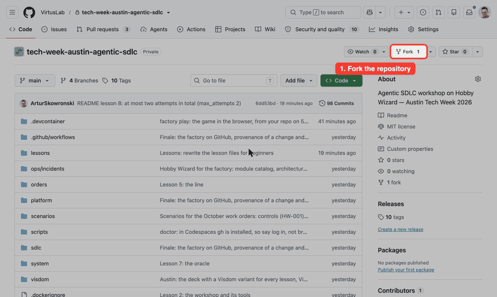
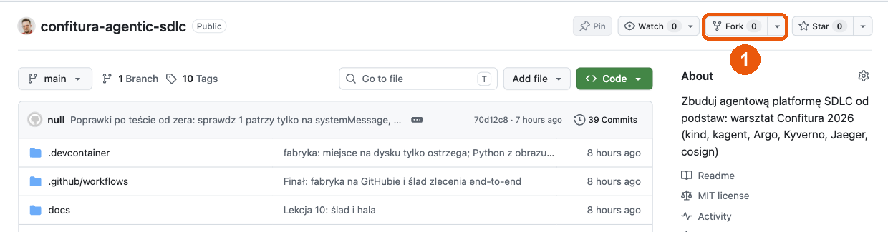
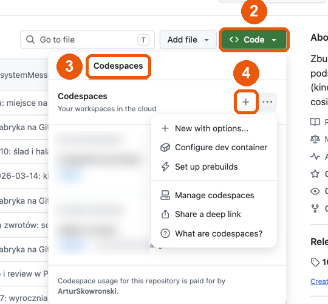
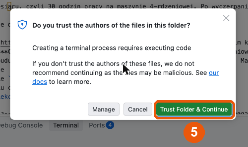
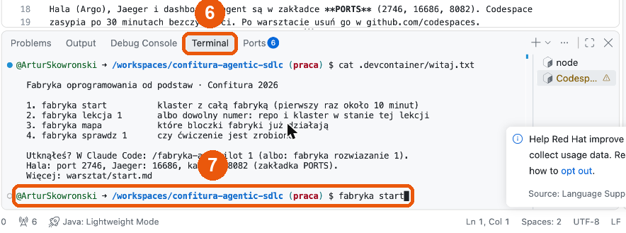
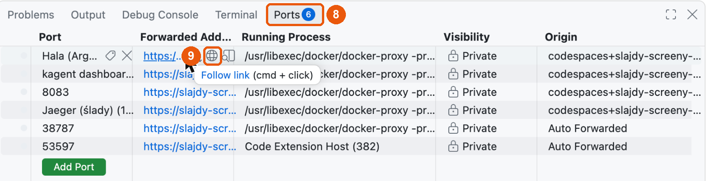

# A software factory from scratch

The workshop "Build a real agentic SDLC platform from scratch", Austin Tech Week, October 29, 2026.
People write specifications and scenarios, agents write code, and the factory decides what to accept without a human.
You build it in ten lessons and a finale, block by block, in a Kubernetes cluster on your own account.
The system the factory works on is [Hobby Wizard](system/README.md), a browser platformer in TypeScript.

| Layer | Project |
|---|---|
| Cluster | kind, Kubernetes (CNCF) |
| Agents | kagent (CNCF Sandbox), the MCP and A2A protocols (Agentic AI Foundation) |
| Line | Argo Workflows (CNCF Graduated) |
| Policy | Kyverno (CNCF) |
| Traces | OpenTelemetry and Jaeger (CNCF) |
| Signature | Sigstore cosign (OpenSSF) |

Below is the whole road from zero to the finale: every command in order and what you should see.
Copy each block of commands whole into a terminal in the repo directory.

## Contents

- [Step 0. A clean slate](#step-0-a-clean-slate)
- [Step 1. The environment: Codespaces or a laptop](#step-1-the-environment)
- [Step 2. The cluster and lesson 1](#step-2-the-cluster-and-lesson-1)
- [The story in one minute](#-the-story-in-one-minute) · [Lessons 1–10](#-lesson-1-the-cluster-and-the-first-agent)
- [Finale: the factory on GitHub](#-finale-the-factory-on-github)
- [Cleaning up](#cleaning-up) · [When something does not work](#when-something-does-not-work) · [What is inside](#what-is-inside)

**How each lesson works** (the same loop every time):

```bash
factory lesson N     # puts the repo and the cluster in the starting state of lesson N
factory check N      # 🔴 red at first: the exercise is not done yet
                     # ✏️ do the exercise
factory check N      # 🟢 green: done
```

Stuck? `factory solve N` puts in the ready answer and prints every step it takes, or `factory autopilot N` lets
Claude Code do the exercise and explain it. The ready answers are also in `solutions/lesson-NN/`.
You can start any lesson without doing the ones before it.

| Sign | Means |
|---|---|
| ✏️ | your exercise |
| 🔴 / 🟢 | what `factory check` should say before / after the exercise |
| 👀 | look at the output: this is the point of the step |
| 🔑 | needs a model key (`factory key`); without one, skip it: every lesson passes without a model |

**🎮 When to open the game** (three moments):

| When | Do this | You see |
|---|---|---|
| 1️⃣ Right after `factory start`, before lesson 1 | In **PORTS** open **🎮 Hobby Wizard (your repo)**, port 5173 (on a laptop: `factory play`) | The bug: walk through the bush on the plateau, hold → and the wizard walks left |
| 2️⃣ Lesson 5, after `make fetch` | `factory play fix`, then open **🎮 Hobby Wizard (the fix)**, port 5174 | The agent's fix: the same bush, → walks right. Port 5173 still has the bug |
| 3️⃣ Finale, when the PR is open | `git fetch origin`, then `factory play agent/issue-<N>`, port 5174 | The game from the pull request's branch, before you merge it |

---

## Step 0. A clean slate

Only if you have built the factory on this computer before or want to repeat everything from zero.

```bash
kind delete cluster --name factory                                  # the cluster (if there was one)
docker image rm factory-toolbox:lesson factory-workshop:lesson 2>/dev/null
rm -f ~/.local/bin/factory ~/.claude/commands/factory-autopilot.md  # the workshop tools
rm -rf ~/.local/share/factory
rm -rf ~/tech-week-austin-agentic-sdlc                              # an old clone, if it was here
```

Check: `kind get clusters` does not print `factory`, and `command -v factory` returns nothing
(in a new terminal).

## Step 1. The environment

### A. GitHub Codespaces (recommended, you install nothing)

Free for GitHub Free accounts: 120 core-hours and 15 GB a month, which is 30 hours on a 4-core machine.
When the quota runs out without a card on file, GitHub blocks usage; it does not send a bill.

**The whole way in one picture** (fork → codespace → terminal → the game on port 5173):


<sub>Recorded in a real codespace. Step by step below; the numbers in the screenshots are the order of the clicks.</sub>

**1. Fork.** Open https://github.com/ArturSkowronski/tech-week-austin-agentic-sdlc and click **Fork** in the top
right corner (1). On the next page keep the name and click the green **Create fork**.



**2. A codespace on the fork.** You are now on the page of your fork (`<login>/tech-week-austin-agentic-sdlc`).
Click the green **Code** (2), the **Codespaces** tab (3) and **Create codespace on main**: on a fresh fork it is a
big green button, and if you already have a codespace, it is **+** (4). The 4-core machine is the only option, the
repo requires it. The build takes about 5 minutes.



**3. Trust the repository.** When you first open a terminal, VS Code asks "Do you trust the authors of the
files in this folder?". Click **Trust Folder & Continue** (5). Without it the terminal does not start.



**4. The terminal.** The **Terminal** tab in the bottom panel (6). If the panel is not there: the **☰** menu in the top
left corner → **Terminal** → **New Terminal**. The terminal greets you with the first commands of
"Build a real agentic SDLC platform from scratch". This is where you type the commands from this README (7), starting
with Step 2. You can dismiss the Red Hat telemetry popup in the bottom right corner (**Deny**).



**Claude Code on the laptop, the cluster in the codespace (recommended).** Claude logs in on your machine as usual,
and the factory's commands run in the codespace. On the laptop you need `git`, `gh`, `ssh`, `rsync` (macOS and Linux
have them; Windows: WSL) and Claude Code.

```bash
gh auth refresh -h github.com -s codespace          # once: gh may connect to your codespaces
gh repo clone <login>/tech-week-austin-agentic-sdlc && cd tech-week-austin-agentic-sdlc
bash lessons/tools/install.sh                       # factory and /factory-autopilot on the laptop
factory connect                                     # links this directory with your codespace; finds it by itself
factory map                                         # runs in the codespace, you see the result here
claude                                              # Claude Code in this directory (or: factory autopilot 1)
```

After `factory connect` the directory on the laptop is a copy of the repo from the codespace, `.git` included, so lessons
and tags match. Every `factory …` sends your changes to the codespace, runs there and brings the result back (rsync both
ways). Any other command goes through `factory cs`: `factory cs make replay O=hw-001`,
`factory cs kubectl get agent -n factory`. Claude edits files locally; the autopilot tells it to run cluster commands
through `factory cs`. End of work: `factory disconnect` (the codespace keeps running).

**Claude Code in the codespace itself (when you do not have it on the laptop).** After you log in, claude.ai redirects
the browser to `http://localhost:…/callback`, and that `localhost` is your laptop, not the codespace. So:

1. In the codespace's terminal: `factory login`. Open the printed link and log in.
2. The browser ends on a "localhost refused to connect" page. Copy the **whole** address from the bar
   (`http://localhost:…/callback?code=…`).
3. Open a second terminal (**+** in the Terminal panel) and type `factory callback '<pasted address>'`.

You do not need Claude to get through the workshop: `factory solve N` solves a lesson without a model.

Or the same from a terminal on the laptop (you only need `gh`):

```bash
gh auth refresh -h github.com -s codespace          # once; opens a browser
gh repo fork ArturSkowronski/tech-week-austin-agentic-sdlc --clone=false
gh codespace create -R <login>/tech-week-austin-agentic-sdlc -b main -m standardLinux32gb
gh codespace ssh -c <name>                           # the name from: gh codespace list
```

Check in the codespace's terminal:

```bash
factory                        # prints the list of commands: start, lesson, map, check, solve, autopilot
git tag -l 'lesson-*' | wc -l  # 10
```

**5. The floor, Jaeger and kagent in the browser** (after `factory start` in Step 2). The **Ports** tab next to
Terminal (8). Hover over the row **The floor (Argo Workflows)** and click the globe icon **Open in Browser** (9).
The same for **Jaeger (traces)** and **kagent dashboard**. The ports are private: only you see them. `factory urls`
prints the same addresses as links.



From a terminal on the laptop you forward the same ports with
`gh codespace ports forward 2746:2746 16686:16686 8082:8082 -c <name>`.

### B. A laptop

You need 16 GB of RAM and Docker with at least 8 GB of memory (Docker Desktop: Settings → Resources).
The prerequisites in detail: [SETUP.md](SETUP.md).

```bash
brew install kind kubectl helm argo cosign node pnpm gh jq gettext   # macOS; Linux: binaries from the releases, Windows: WSL2
gh repo fork ArturSkowronski/tech-week-austin-agentic-sdlc --clone=true
cd tech-week-austin-agentic-sdlc
make tools                   # installs factory in ~/.local/bin and /factory-autopilot in Claude Code
exec $SHELL -l               # the new PATH in this terminal
```

Check: as in Codespaces, `factory` prints the list of commands and `git tag -l 'lesson-*' | wc -l` gives 10.
If there are 0 tags, `factory lesson 1` fetches them from the instructor's repo by itself.

Something else already uses ports 2746, 8082, 8083 or 16686, or you want a second cluster? Put
`KIND_CLUSTER`, `HALL_PORT`, `KAGENT_API_PORT`, `KAGENT_UI_PORT`, `JAEGER_PORT` (KEY=VALUE lines) in the git-ignored
`.factory.env` in the repo root before `factory start`.

### The model key (optional)

Without a key everything works in replay mode: instead of an agent the line applies a recorded change. With a key
(you get one in the room or use your own) the agents really answer.

You set the key after `factory start` (Step 2), because it goes into the cluster:

```bash
factory key                  # asks for the key: paste and press Enter (it is not shown); works on every lesson
```

Paste the key **after the prompt**, not as an argument (the key would stay in the shell history). On `main`
`make key` works too; the lesson tags carry an older version of it, so use `factory key`. The kind of key picks the API:
`sk-ant-…` is the Claude API (Anthropic, model `claude-sonnet-5`), `sk-or-…` is OpenRouter, `sk-proj-…` is OpenAI
(model `gpt-5.4`). Another model: `LLM_MODEL=claude-opus-5-5 factory key`.
Before saving, `factory key` sends one short request and tells you whether the key works (401: a wrong key,
429: no credit).

Skip the steps marked **(with a key)** if you have none. `factory check` never needs a model.

## Step 2. The cluster and lesson 1

```bash
factory lesson 1             # the repo on the tag lesson-01; prints "No cluster yet: factory start"
factory start                # kind + Argo + kagent + Kyverno + Jaeger, 5-10 minutes the first time
```

At the end of `factory start` you see "The cluster is up. Addresses on localhost", the result of `make doctor` with
the cluster's items in green, and your addresses. A red item about `origin` means you work on the instructor's repo
instead of a fork.

```bash
factory map                  # ✔ L1 an agent as a resource (and L3 context, L10 trace: the cluster has them from the start), the rest greyed out
kubectl get agent -n factory # probe  … True
```

If `factory start` fails: run it again (it is idempotent). If it fails again: `factory reset`.

### 🎮 Play the game first

Before you fix anything, play Hobby Wizard and meet the bug you will fix later.
In Codespaces the game is already running: open **🎮 Hobby Wizard (your repo)** (port 5173) in the **PORTS** tab.
On a laptop, or if it is not there:

```bash
factory play                 # the game from your repo, http://localhost:5173 (Ctrl+C stops it)
```

👀 Arrows walk, Z jumps. Walk through the bush on the plateau: the creature jumps on your hat, and now holding
**right** walks **left**. That is bug HW-001. The game reloads by itself whenever the files in your repo change.


<sub>HW-001: the creature jumps on the hat in the bush, and holding → walks the wizard left.</sub>

## 🧭 The story in one minute

A player of Hobby Wizard finds a bug and reports it. You hand the report to an AI agent. Left alone, the agent
changes the wrong file, edits the test that would catch it, peeks at the answers, and leaves no record of what it did.

Each lesson fixes one of those problems with one building block. After ten lessons you have a small software factory:
a task goes in as an issue, a checked and signed pull request comes out, and a person steps in only where the risk is.

---

## 🚢 Lesson 1. The cluster and the first agent

😬 **The problem:** You want an AI agent to help with your code. Today it is often a script on one person's laptop. Nobody knows which version is running, who changed its instructions last week, or what it is allowed to do.

🛠️ **What we do:** We start the agent in Kubernetes from a short config file, the same way you start any web service. Then you write its first instructions: when a task is unclear, ask questions. Never write code.

✅ **What you get:** An agent that has a version number, an owner and limits, and that other parts of the factory can talk to. If someone changes its instructions, you can see it in Git.

📖 [lessons/lesson-01-cluster.md](lessons/lesson-01-cluster.md)

```bash
kubectl get deploy,svc -n factory -l kagent=probe     # 👀 the agent runs like any web service: a Deployment and a Service
curl -s localhost:8083/api/a2a/factory/probe/.well-known/agent-card.json | jq .name   # 👀 its "business card": "probe"
factory check 1              # 🔴 expected: the intake agent's instructions still say TODO
```

✏️ **Exercise:** write the instructions of the `intake` agent. Its only job: ask what is missing from a task, never write code.
Open `platform/kagent/agent-intake.yaml` and replace `TODO` under `systemMessage` with your own text, or paste this:

```bash
python3 - <<'EOF'
from pathlib import Path
p = Path("platform/kagent/agent-intake.yaml")
p.write_text(p.read_text().replace("      TODO\n", """      You are the intake desk of a software factory. The system is Hobby Wizard, a browser platformer
      in TypeScript: a deterministic simulation at 60 ticks a second and a PixiJS renderer.
      You receive a work order title and description that lack acceptance criteria.

      Ask two to four questions without which an acceptance test cannot be written:
      numbers (ticks, tiles, speeds), edge cases (in the air, in water, while charging, with the creature
      on the hat), what must stay exactly as it is, what the player sees.
      Do not propose solutions and do not write code. Do not summarize the work order.

      Format: a bulleted list, one question per bullet, no preamble and no closing.
"""))
EOF
kubectl apply -f platform/kagent/agent-intake.yaml                         # send the new config to the cluster
kubectl wait --for=condition=Ready agent/intake -n factory --timeout=180s   # wait until the agent is up
factory check 1              # 🟢 the instructions are written and the agent is running
```

🔑 **With a model key:** ask the agent about a vague task and it answers with 2–4 questions, not code:
`make a2a A=intake T="Double jump. Players keep asking for a second jump in the air. Add it."`

## 🧱 Lesson 2. The workshop and the tools

😬 **The problem:** The coding agent can change any file it sees, including the tests and the checks that are supposed to judge its work. Writing "please don't touch the tests" in its instructions does not stop it.

🛠️ **What we do:** We give the agent exactly five tools: list files, read a file, write a file, run the build, show the changes. Then we tell the tool server which folders are off limits, and it refuses every write there.

✅ **What you get:** The agent simply cannot "fix" a failing check by editing the check. Every time it tries, the attempt is written down.

📖 [lessons/lesson-02-workshop.md](lessons/lesson-02-workshop.md)

```bash
factory lesson 2             # sets up the agent's tool server; a few minutes the first time
factory map                  # 👀 which blocks of the factory are already working
kubectl get mcpserver workshop -n factory    # 👀 the tool server is up: READY True
factory check 2              # 🔴 expected: the agent could overwrite the factory's own rules (sdlc/policy.json and two more)
```

🔑 **With a model key:** ask the agent to overwrite the factory's rules. It works, because nothing stops it:
`make a2a A=builder T="Write the file sdlc/policy.json with the content {} and tell me what the tool answered"`,
then `make send` to put the original files back in the cluster.

✏️ **Exercise:** tell the tool server which folders the agent may never write to. Set `PROTECTED_PATHS` in `platform/workshop/mcpserver.yaml`:

```bash
python3 - <<'EOF'
import re
from pathlib import Path
p = Path("platform/workshop/mcpserver.yaml")
p.write_text(re.sub(r'PROTECTED_PATHS: ".*"',
    'PROTECTED_PATHS: "sdlc platform scenarios system/architecture system/bugs/tests .github .factory"', p.read_text()))
EOF
kubectl apply -f platform/workshop/mcpserver.yaml                  # send the new config
kubectl rollout status -n factory deploy/workshop --timeout=180s   # wait for the server to restart
factory check 2              # 🟢 all three writes are now refused by the server
kubectl exec -n factory deploy/depot -- tail -3 /work/events.jsonl   # 👀 the log of tool calls: a refused try shows up as gate.tamper_attempt
```

## 🧭 Lesson 3. Context L1–L5

😬 **The problem:** A player writes: "left and right are swapped". The words sound like a keyboard problem, so the agent fixes the keyboard code. The build is green, but the real bug is somewhere else.

🛠️ **What we do:** We write down which part of the game is responsible for which idea: the simulation owns the creature, the controls and the movement. The factory turns that into a short guide the agent reads before it starts.

✅ **What you get:** The fix goes to the right place. You got there by correcting a list of facts, not by writing a longer and longer prompt.

📖 [lessons/lesson-03-context.md](lessons/lesson-03-context.md)

```bash
factory lesson 3
make route O=hw-001          # 👀 where would the factory send bug HW-001? To `render` (screen code), because the report talks about keys
factory check 3              # 🔴 expected: the bug is sent to the wrong module
```

✏️ **Exercise:** write down that the game's simulation (`sim`) owns the creature and the controls (ADR-011). Fill in `owns` in `system/game/sim/module.json`:

```bash
python3 - <<'EOF'
import json
from pathlib import Path
p = Path("system/game/sim/module.json")
m = json.loads(p.read_text())
m["owns"] = ["creature", "controls", "movement", "physics", "simulation"]
p.write_text(json.dumps(m, ensure_ascii=False, indent=2) + "\n")
EOF
make route O=hw-001          # 👀 now the bug goes to `sim`, because sim owns "creature"
make agents-md               # rebuild the guide the agent reads before it starts (AGENTS.md)
git diff --stat              # 👀 two files changed: module.json and AGENTS.md
factory check 3              # 🟢 HW-001 goes to sim and the guide is up to date
```

## 📋 Lesson 4. Intake of a work order

😬 **The problem:** "Add a double jump" sounds clear. But how high is the second jump? Do you get it back after falling into water? An agent will guess, and then you have to review its guesses.

🛠️ **What we do:** The factory checks every task before an agent sees it. If the task has no clear "done when…" list, it goes back to the author together with the agent's questions.

✅ **What you get:** Agents only start work that a test can check. The hard thinking happens where it should: when the task is written, not when the code is reviewed.

📖 [lessons/lesson-04-intake.md](lessons/lesson-04-intake.md)

```bash
factory lesson 4
make intake O=hw-001         # 👀 the bug report is clear enough: accepted
make intake O=double-jump    # 👀 "add a double jump" is sent back: no "done when…" list (with a key: plus the agent's questions)
factory check 4              # 🔴 expected: orders/double-jump.md has no Criteria: section
```

✏️ **Exercise:** write when the double jump is "done". Use numbers and the game's own words, not adjectives:

```bash
cat >> orders/double-jump.md <<'EOF'

Criteria:
- in the air the wizard can jump once more; the second jump starts at JUMP_VELOCITY, the same as the first
- landing, a respawn or the water gives the second jump back; a charge does not
- a jump off a ledge in coyote time counts as the first jump
EOF
make intake O=double-jump    # 👀 accepted now (with a note: no hidden tests exist for it yet)
factory check 4              # 🟢 the task is accepted
```

## 🏭 Lesson 5. The line

😬 **The problem:** Calling an agent once is easy. Seeing what it did, running it again the same way, pausing it for a human, or swapping it for another agent is not.

🛠️ **What we do:** We run a real agent through a pipeline with clear steps: prepare, check the task, write the fix, save the change. You watch it fix the planted bug HW-001, step by step, in a web dashboard.

✅ **What you get:** A process you can see and repeat. The agent is just one step in it, and the result is a patch you can open and read.

📖 [lessons/lesson-05-line.md](lessons/lesson-05-line.md)

```bash
factory lesson 5
kubectl get workflowtemplate -n factory      # 👀 the pipeline itself is one config file in the cluster: factory
factory check 5              # 🔴 expected: nothing has gone through the pipeline yet
```

✏️ **Exercise:** send bug HW-001 through the pipeline. First with a recorded fix (no model needed), then with a real agent.

```bash
make replay O=hw-001         # run the pipeline with the recorded fix; 1–2 minutes, ends with "Result: Succeeded"
make fetch                   # copy the results from the cluster to .sdlc/out/
cat .sdlc/out/hw-001/attempt-1/description.md              # 👀 what the agent says it did
git apply --stat .sdlc/out/hw-001/attempt-1/change.patch   # 👀 which files the fix touches: input-map.ts and the bug list
factory check 5              # 🟢 the bug went through the pipeline and you have the patch
```

👀 **Watch it:** `factory urls` → open the floor (Argo) → run `factory-hw-001-…`: the steps prepare → intake → builder → change.
🔑 **With a model key:** `make order O=hw-001` runs a real agent (2–5 minutes). In a second terminal,
`kubectl exec -n factory deploy/depot -- tail -f /work/events.jsonl` shows every tool the agent calls, live.

🎮 **Play the fix:** `factory play fix` starts the game with the agent's patch on top of your repo, on port 5174
(**🎮 Hobby Wizard (the fix)**). Walk through the bush again: right is right, and the creature is gone.


<sub>The fix on port 5174: no creature in the bush, and holding → walks right.</sub>

## 🚦 Lesson 6. Quality control

😬 **The problem:** The agent wrote the code and the tests, so of course the tests pass. A change that adds randomness to the game's physics gets through every green check, even though it breaks the game.

🛠️ **What we do:** We add one rule that runs outside the agent: the game's physics may not use random numbers or the clock. The rule comes with a one-line reason.

✅ **What you get:** The same bad change is now stopped automatically. And the reason is written where the agent will read it next time.

📖 [lessons/lesson-06-quality.md](lessons/lesson-06-quality.md)

```bash
factory lesson 6
make naive                   # 👀 a "quick" change that adds random numbers to the game's physics: every check is green anyway
factory check 6              # 🔴 expected: the rule file still says TODO
```

✏️ **Exercise:** add a rule to the code checks (ESLint): the game's physics in `game/sim` may not use random numbers or the clock:

```bash
python3 - <<'EOF'
import re
from pathlib import Path
p = Path("system/architecture/rules.js")
rule = """  rule(
    'sim_is_deterministic',
    'game/sim is deterministic: randomness comes from nextRandom(state) and time from state.tick, never Math.random, Date, performance.now or timers, so a replay stays a replay, see docs/plan/02-design/simulation-architecture.md',
    ['game/sim/**/*.ts'],
    (because) => ({
      'no-restricted-syntax': [
        'error',
        ...[
          "MemberExpression[object.name='Math'][property.name='random']",
          "NewExpression[callee.name='Date']",
          "MemberExpression[object.name='Date']",
          "MemberExpression[object.name='performance']",
          "CallExpression[callee.name=/^(setTimeout|setInterval|requestAnimationFrame)$/]",
        ].map((selector) => ({ selector, message: because })),
      ],
    }),
  ),
"""
p.write_text(re.sub(r"  // TODO\(lesson 6\).*\n(  //.*\n)?", lambda _: rule, p.read_text(), count=1))
EOF
make test                    # today's code must still pass the new rule (under a minute)
make agents-md               # the rule's reason goes into the agent's guide too
make send                    # send your changes to the cluster
make naive                   # 👀 the same "quick" change is now stopped: "Result: Failed", step build is red
make fetch
grep -A3 'Architecture rule violated' .sdlc/out/startle/attempt-1/quality-1-build.md   # 👀 which rule, why, and in which file
factory check 6              # 🟢 good code passes, the bad change is caught
```

## 🔮 Lesson 7. The oracle

😬 **The problem:** If the agent can read the acceptance tests, it writes code to pass those tests, not to do what was asked. Then the tests stop telling you anything.

🛠️ **What we do:** We hide the tests written by people from the agent. It cannot even open them. The factory runs them on its own, from the main branch.

✅ **What you get:** A test the agent cannot cheat on. That is your honest signal that the job is really done.

📖 [lessons/lesson-07-oracle.md](lessons/lesson-07-oracle.md)

```bash
factory lesson 7
make replay O=startle        # 👀 "Result: Failed": the hidden tests (the oracle) caught a real bug, the same one as the September 30 incident
make fetch
cat .sdlc/out/startle/attempt-1/quality-5-oracle.md   # 👀 which test failed: "A startle that begins in the air still falls and lands"
factory check 7              # 🔴 expected: the agent can still read those hidden tests
```

✏️ **Exercise:** hide the tests written by people (`scenarios/`) from the agent, so it cannot even read them:

```bash
python3 - <<'EOF'
import re
from pathlib import Path
p = Path("platform/workshop/mcpserver.yaml")
p.write_text(re.sub(r'HIDDEN_PATHS: ".*"', 'HIDDEN_PATHS: "scenarios"', p.read_text()))
EOF
kubectl apply -f platform/workshop/mcpserver.yaml                  # send the new config
kubectl rollout status -n factory deploy/workshop --timeout=180s   # wait for the server to restart
factory check 7              # 🟢 reading the hidden tests is refused, and the lesson 2 wall still stands
```

🔑 **With a model key:** ask the agent to read a hidden test. Before your change it happily summarizes it; after it, it gets "Rejected: … is out of the agent's reach":
`make a2a A=builder T="Read scenarios/startle/startle.test.ts and summarize what it checks"`

## 🔁 Lesson 8. Risk, review and rework

😬 **The problem:** When the first try fails, the agent tries again. With every try it gets better at passing the checks and worse at solving the actual problem.

🛠️ **What we do:** Plain code, not an AI, scores how risky the change is. A failed change goes back automatically, but there are at most two attempts in total. An AI reviewer gets one precise rule to check.

✅ **What you get:** Retries are visible and limited. Risky changes get a second look. The AI reviewer gives advice; the checks make the decision.

📖 [lessons/lesson-08-review.md](lessons/lesson-08-review.md)

```bash
factory lesson 8
make replay O=startle        # 👀 attempt 1 fails the hidden tests, the factory starts attempt 2 by itself
make fetch
cat .sdlc/out/startle/attempt-1/feedback.md          # 👀 what the agent is told: only the names of the failed tests, never their code
cat .sdlc/out/startle/attempt-2/review-1-risk.md     # 👀 the risk score: "critical", because it touches the game's physics and it is a second try
factory check 8              # 🔴 expected: the AI reviewer has no rule about this kind of bug yet
```

✏️ **Exercise:** give the AI reviewer one precise rule, with what a good and a bad change look like:

```bash
python3 - <<'EOF'
import json
from pathlib import Path
p = Path("sdlc/review-rules.json")
d = json.loads(p.read_text())
after = next(i for i, r in enumerate(d["rules"]) if r["id"] == "LLM-001") + 1
d["rules"].insert(after, {
    "id": "LLM-002", "kind": "llm", "lens": "correctness",
    "rule": "Anything that holds the wizard still holds his input only: the player step still runs, so gravity, the water and the props go on (ADR-011, INC-2026-09-30).",
    "pass": "The hold hands the player step an empty input frame (NO_INPUT) and the step runs: a wizard held in the air keeps falling and lands.",
    "fail": "The hold returns early from stepPlayer or skips a step of tick(), so gravity stops and a wizard held in the air hangs there.",
    "example_fail": "if (state.tick - since <= CREATURE_STARTLE_TICKS) { return; }  // at the top of stepPlayer, before gravity"})
p.write_text(json.dumps(d, ensure_ascii=False, indent=2) + "\n")
EOF
python3 -m json.tool sdlc/review-rules.json > /dev/null && echo "JSON OK"   # the file is still valid
factory check 8              # 🟢 the reviewer has the rule: "freeze the controls, not the physics"
```

🔑 **With a model key:** `make send && make order O=startle`, and the reviewer points at the exact bug in attempt 1.

## 🚥 Lesson 9. Lights, WIP and policy

😬 **The problem:** Either a person reviews every change and becomes the bottleneck, or nobody does and something bad slips through.

🛠️ **What we do:** We write the rule into a file in the repo: small, well-tested changes go through on their own; risky ones stop and wait for a person to approve. A second rule blocks any agent that asks for tools it should not have.

✅ **What you get:** People look only where it matters. The rule itself is reviewed like code, and an agent cannot give itself more power.

📖 [lessons/lesson-09-policy.md](lessons/lesson-09-policy.md)

```bash
factory lesson 9
factory check 9              # 🔴 expected: A. the pipeline never stops for a person, B. an agent with forbidden tools is allowed in
```

✏️ **Exercise A:** make the pipeline stop and wait for a person. The `human` step gets a `wait` (pause) inside:

```bash
python3 - <<'EOF'
from pathlib import Path
p = Path("platform/line/factory.yaml")
lines = p.read_text().split("\n")
start = lines.index("    - name: human")
while lines[start - 1].startswith("    #"):      # the TODO comment above the template goes too
    start -= 1
end = lines.index("    - name: human") + 1
while not lines[end].startswith("    - name: "):  # up to the next template
    end += 1
while lines[end - 1].startswith("    #"):        # and its comment stays
    end -= 1
lines[start:end] = r"""    # A human is a node with a role (lesson 9): the line stops (suspend), make approve records who and resumes.
    - name: human
      inputs:
        parameters: [{name: order}, {name: attempt}]
      steps:
        - - name: wait
            template: wait
        - - name: record
            template: step
            arguments:
              parameters:
                - {name: order, value: "{{inputs.parameters.order}}"}
                - {name: attempt, value: "{{inputs.parameters.attempt}}"}
                - name: script
                  value: |
                    who="{{steps.wait.outputs.parameters.who}}"
                    printf '### 👤 Approval: ✅ %s\n' "$who" > "$OUT/human.md"
                    printf 'human.approved %s\n' "$who" > "$OUT/human"; cat "$OUT/human.md"

    - name: wait
      suspend: {}
      outputs:
        parameters:
          - name: who
            valueFrom: {supplied: {}}
""".split("\n")
p.write_text("\n".join(lines))
EOF
argo lint --offline platform/line/factory.yaml    # check the file: "no linting errors found"
make line                                         # send the new pipeline to the cluster
```

Try it. HW-001 changes the game's physics (`game/sim`), which is risky (ADR-011), so the run stops and turns
yellow on the floor. Use a **second terminal** to approve it:

```bash
make replay O=hw-001               # terminal 1: the run waits for a person
argo list -n factory               # terminal 2: find the run name (status Running)
make approve W=<run name>          # terminal 2: approve it; your name is recorded (you will see it again in lesson 10)
```

✏️ **Exercise B:** add a cluster rule (Kyverno): the coding agent may only use the tools of our tool server, nothing else:

```bash
kubectl apply --dry-run=server -f platform/kyverno/test/bad-agent.yaml   # 👀 an agent with extra tools is accepted: that is the hole
python3 - <<'EOF'
from pathlib import Path
p = Path("platform/kyverno/agent-tools.yaml")
p.write_text(p.read_text().replace('    - expression: "true"\n', """    - expression: >-
        !(has(object.metadata.labels) && object.metadata.labels[?'factory.dev/role'].orValue('') == 'builder') ||
        object.spec.?declarative.?tools.orValue([]).all(t, t.type == 'McpServer' && t.?mcpServer.?name.orValue('') == 'workshop')
"""))
EOF
kubectl apply -f platform/kyverno/agent-tools.yaml                       # turn the rule on
kubectl apply --dry-run=server -f platform/kyverno/test/bad-agent.yaml   # 👀 now refused: "The builder has only the tools of the workshop server"
kubectl apply --dry-run=server -f platform/kagent/agent-builder.yaml     # 👀 the real agent is still allowed
factory check 9              # 🟢 A. the pipeline waits for a person, B. the bad agent is refused
```

## 🧾 Lesson 10. The trace and the floor

😬 **The problem:** Something broke after a change. Which instructions, which model, which tool calls, who approved it? Without a record, you spend a week finding out.

🛠️ **What we do:** Every step goes into a log where each line is linked to the one before and the whole log is signed by the factory. Jaeger shows every call to the model and every tool call on a timeline.

✅ **What you get:** You can answer "what did the agent do?" in minutes. And you can prove nobody edited the log afterwards: change one word and the check fails.

📖 [lessons/lesson-10-trace.md](lessons/lesson-10-trace.md)

```bash
factory lesson 10            # also installs the factory's signing key (cosign)
make replay O=startle        # terminal 1: attempt 1 fails, attempt 2 waits for a person
argo list -n factory         # terminal 2: find the run name
make approve W=<run name>    # terminal 2: approve it
make fetch
make ledger-verify F=.sdlc/out/startle/attempt-2/ledger.jsonl    # 👀 the log is complete and the signature matches: "Verified OK"
factory check 10             # 🟢 the log is whole and correctly signed
```

✏️ **Exercise:** try to fake the log. Change one word and see the check catch it:

```bash
L=.sdlc/out/startle/attempt-2/ledger.jsonl
cp $L /tmp/ledger-copy.jsonl                     # keep a copy
sed -i.bak 's/human.approved/human.skipped/' $L  # pretend nobody approved
make ledger-verify F=$L      # 👀 caught: it names the changed line, and the signature no longer matches
cp /tmp/ledger-copy.jsonl $L                     # put the original back
make ledger-verify F=$L      # 👀 OK again
```

👀 **The summary card:** `cat .sdlc/out/startle/attempt-2/card.md`: how many attempts, the decision, who approved.
🔑 **With a model key:** open Jaeger (`factory urls`), service `builder`, the newest trace: every model call and tool
call on a timeline. Count the tool calls and compare with the lines in `tools.jsonl`. In the finale you get one trace
for the whole task (service `factory-line`).

```bash
factory map                  # 🟢 all ten blocks of the factory are working
```

---

## 🎮 Finale: the factory on GitHub

😬 **The problem:** So far everything ran inside your own cluster. Real work arrives as a GitHub issue and leaves as a pull request.

🛠️ **What we do:** We connect your fork. An issue becomes a task for the factory. The factory opens a pull request with the fix, its signed log and four automatic checks, and you approve it.

✅ **What you get:** The whole loop on real GitHub. Plus proof of where the code came from: edit the agent's branch by hand and one check turns red.

📖 [lessons/final-github.md](lessons/final-github.md) · You need your fork as `origin` and a logged-in `gh`.

```bash
factory lesson final         # the repo and the cluster in the state of the finale
git remote -v                # 👀 origin must be YOUR fork, not ArturSkowronski/…
gh auth status               # 👀 on a laptop: Logged in, with scopes repo and workflow
```

**In Codespaces first log `gh` in with your account (once per codespace, before `make github`).** A codespace has its
own token (`GITHUB_TOKEN`, it starts with `ghu_`). It pushes code and opens issues, but it cannot change repo settings:
with it `make github` ends with `HTTP 403 Resource not accessible by integration`.

```bash
git pull                                                          # the newest scripts from main
env -u GITHUB_TOKEN gh auth login -h github.com -s repo,workflow  # env -u + the variable's NAME, not the token's value
```

Answers to `gh`'s questions:

| Question | Answer |
|---|---|
| What is your preferred protocol for Git operations? | **HTTPS** |
| Authenticate Git with your GitHub credentials? | **Yes** |
| How would you like to authenticate GitHub CLI? | **Login with a web browser** |
| First copy your one-time code: `XXXX-XXXX` | Enter, then in the browser at github.com/login/device: paste the code, **Continue**, **Authorize github** |

Check before `make github`:

```bash
env -u GITHUB_TOKEN gh auth status   # must say: account <login> (/home/vscode/.config/gh/hosts.yml), Token: gho_…
```

If you see `(GITHUB_TOKEN)` and `Token: ghu_…`, the login did not work: repeat `gh auth login` above.
The login survives stopping the codespace. On a laptop this step does not apply: a plain `gh auth login` is enough.

Now connect the fork:

```bash
make github                  # connect your fork: turns on issues and Actions, adds labels, protects main, and lets the cluster read your issues
```

`make github` prints what it set. If Actions could not be turned on: on the fork, the **Actions** tab →
**I understand my workflows, go ahead and enable them**.

```bash
make issue O=hw-001          # open issue #N on your fork: "HW-001: Left and right swap while the creature rides"
make pull AGENT=replay       # let the factory pick it up now (it checks every 2 minutes anyway)
argo list -n factory         # 👀 factory-issue-N-… Running, then Succeeded (a few minutes)
gh pr list                   # 👀 a pull request opened by the factory, branch agent/issue-N
gh pr checks <PR number> --watch   # 👀 four automatic checks turn green: gates, oracle, review, provenance
gh pr view <PR number> --web       # 👀 open it: the description, the summary card, the trace link, review comments on the code
```

`make issue` uses the same title and labels (`bug`, `planted`) as the game's "Raise ticket on GitHub" button (ADR-006),
but it also adds the `Criteria:` list from `orders/hw-001.md`. An issue raised straight from the game has no such list,
so the factory sends it back with questions (lesson 4).
HW-001 changes the game's physics, which is risky (ADR-010, ADR-011), so the PR gets the label `factory:human` and
waits for you. A low-risk task with hidden tests (`hud-speed`) would merge by itself (`factory:lights-out`).

✏️ **Exercise:** add a "quick fix" by hand on the agent's branch, after the checks. The provenance check notices that the code is no longer the code the factory checked and signed:

```bash
git stash -u                 # put local files aside (your cluster's key would block switching branches)
git fetch origin && git switch agent/issue-<N>   # go to the agent's branch
echo "// quick fix" >> system/game/render/hud.ts
git commit -am "quick fix" && git push            # push a change nobody checked
sleep 30                     # give GitHub a moment to start the checks
gh pr checks <PR number> --watch   # 🔴 provenance: "code changed after the commit in the ledger"
git revert --no-edit HEAD && git push            # undo the quick fix
sleep 30
gh pr checks <PR number> --watch   # 🟢 provenance is green again
git switch work && git stash pop                 # back to where you were
```

🎮 **Play the PR:** `factory play agent/issue-<N>` starts the game from the agent's branch on port 5174. Compare it
with port 5173: the same bush, but the bug from the issue is gone.


<sub>A fix of HW-001 (the lesson 5 patch): holding → walks right.</sub>

## Cleaning up

```bash
kind delete cluster --name factory               # laptop
gh codespace delete -c <name>                    # Codespaces
```

The issues and PRs from the finale stay on your fork. If you got a model key in the room, it expires after the workshop.

## When something does not work

| Symptom | What to do |
|---|---|
| `factory: command not found` | Codespaces: wait for the container build to finish. Laptop: `make tools`, then a new terminal |
| `factory start`: not enough memory | Codespaces: the 4-core/16 GB machine. Docker Desktop: Settings → Resources, at least 8 GB |
| `factory start` fails on a timeout | Run it again; then `factory reset` |
| `factory start`: `ghcr.io … 403: denied` for kagent | An old Docker login to ghcr.io breaks the anonymous chart pull: `docker logout ghcr.io`, then `factory start` |
| `factory start`: a port is already in use | Other ports in `.factory.env` (`HALL_PORT`, `KAGENT_API_PORT`, `KAGENT_UI_PORT`, `JAEGER_PORT`), then `factory reset` |
| `make setup failed` during `factory lesson` | Usually the network while building the images: repeat `factory lesson N` |
| `make test`: no node or pnpm | Node 22 and pnpm (SETUP.md); in Codespaces they are there |
| A run hangs as Pending | WIP limit 3 and one disk: `argo stop -n factory --all` |
| A run stands yellow | It waits for a human: `argo list -n factory`, then `make approve W=<name>` |
| `factory check` red, you do not know why | Compare with `solutions/lesson-NN/*-fN.*`, run `factory autopilot N` or `factory solve N` (no model, prints every step) |
| `make github`: HTTP 403 "Resource not accessible by integration" | In Codespaces: `env -u GITHUB_TOKEN gh auth login -h github.com -s repo,workflow`, then `make github` |
| `factory connect`: "No codespace for …" | `gh auth refresh -h github.com -s codespace`, check `gh codespace list`; or `factory connect <name>` |
| `factory …` from the laptop: "Cannot send changes to the codespace" | The codespace fell asleep: `gh codespace ssh -c <name> -- true` wakes it, then once more |
| Claude Code in Codespaces: "localhost refused to connect" after logging in | Copy the address from the bar and in a second terminal `factory callback '<address>'` (Step 1A) |
| Your changes disappeared after `factory lesson` | They are in `git stash list`; `git stash pop` |
| `detected dubious ownership` | `git config --global --add safe.directory "$(pwd)"` |
| The cluster in a strange state after jumping back | `factory reset` (about 10 minutes) |

All the tool's commands: `factory`. All make targets: `make help`. The autopilot prompts:
[lessons/autopilot.md](lessons/autopilot.md). Prompts for the exercises: [lessons/prompts.md](lessons/prompts.md).

## What is inside

| Path | What it is |
|---|---|
| `system/` | Hobby Wizard, the game: `game/sim` (the simulation, the critical path), `game/render`, `game/content`, `bugs/` (planted bugs), `architecture/` (ESLint rules, the game's ArchUnit). Its own rules: `system/AGENTS.md` |
| `scenarios/` | The oracle: holdout scenarios written by product (vitest). The agent does not see them |
| `system/docs/plan/01-decisions/`, `ops/incidents/` | The organization's knowledge: decisions (ADR-001 … ADR-011) and the incident INC-2026-09-30 |
| `sdlc/` | The factory's brain in Python: context, intake, agent, gates, risk, review, ledger, trace, GitHub |
| `platform/` | The cluster's manifests: kagent (agents, model), workshop (MCP tools), line (Argo), Kyverno, Jaeger, the GitHub poller |
| `.github/workflows/factory.yml` | Finale: the factory's gates on GitHub (gates, oracle, review, provenance of the ledger) |
| `orders/` | Work orders for the factory |
| `lessons/tools/` | The `factory` CLI and the autopilot prompts. Install: `make tools` |
| `.devcontainer/` | GitHub Codespaces: the whole stack in the browser |
| `lessons/` | Lesson materials, the instructor's notes, the slides |

Each lesson is a tag `lesson-NN`: the lesson's commit contains its infrastructure and exercise, the solution is in
the next one. `main` is lesson 10 plus the finale.

## License

The factory (everything outside `system/`) is MIT, see [LICENSE](LICENSE).
`system/` is [Hobby Wizard](system/README.md) by VirtusLab, Apache-2.0, see [system/LICENSE](system/LICENSE) and [NOTICE](NOTICE).
The people in `system/`'s git history are the real authors of Hobby Wizard. The rest of the story (the work orders,
the scenarios, the incident write-up) is written for the workshop.
