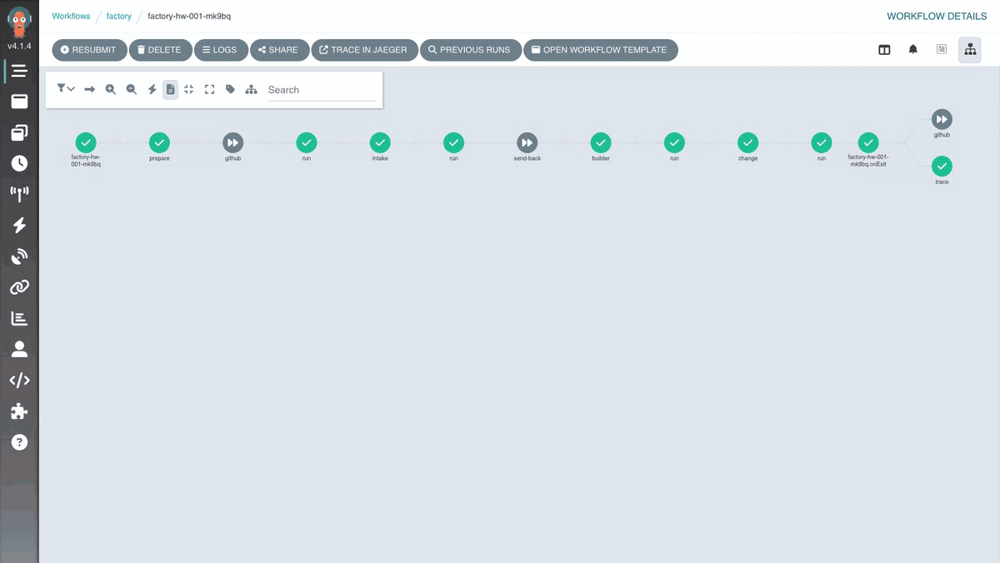
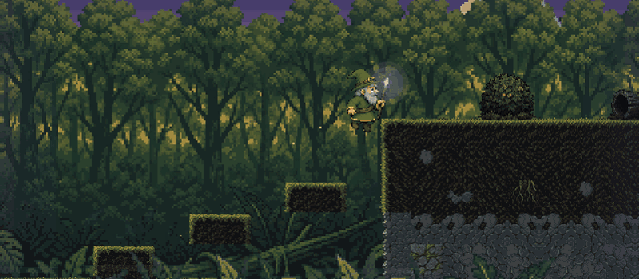
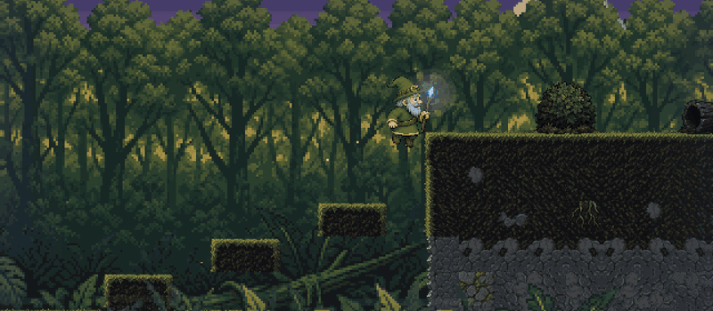

# Lesson 5: The line (12 min)

😬 **Problem:** calling an agent once is easy. Seeing what it did, running it again the same way, pausing it for a human, or swapping it for another agent is hard.

🛠️ **What we do:** we run the agent through a pipeline with clear steps: prepare, check the task, write the fix, save the change. You watch it fix the planted bug HW-001, step by step, in a web dashboard.

✅ **What you get:** a process you can see and repeat. The agent is one step in it, and the result is a patch you can open and read.

## How it works

The pipeline is called the line. It runs in Argo Workflows, which draws the steps as a graph, keeps their logs
and can pause a run for a human (lesson 9). Every step is a container with the same image and the same disk;
only the script differs.

```
prepare ──────▶ intake ───────▶ builder ──────▶ change
branch of       routing         A2A to          commit on branch agent/<order>,
the order       + criteria      the builder     patch and description in /work/out
```

| Part | File |
|---|---|
| The line's template | `platform/line/factory.yaml` (WorkflowTemplate `factory`) |
| The steps' account | `platform/line/rbac.yaml` |
| The agent driver | `sdlc/agent.py`: builds a prompt from the L1-L5 context, then calls the agent over A2A or applies a recorded patch |
| Recordings | `sdlc/replays/`: a recorded patch per work order, module and attempt number |

The agent is replaceable: `kagent` (a real model) or `replay` (a recorded patch that works without a model). Only the
`builder` step talks to the agent, over A2A through the kagent controller. The model key stays in the agent's pod.

## ✏️ Exercise: send HW-001 through the line (8 min)

1. Set up the lesson: `factory lesson 5`.
2. See the line in the cluster: `kubectl get workflowtemplate -n factory`.
   👀 You should see: one template, `factory`.
3. Run `factory check 5`.
   🔴 You should see: `no successful run of HW-001: make replay O=hw-001`.
4. Run HW-001 with the recorded fix: `make replay O=hw-001` (1 to 2 minutes).
   👀 You should see at the end: `Result: Succeeded`.
5. Watch it on the floor (the Argo dashboard): `factory urls` (or `make floor`), open the floor, click the run `factory-hw-001-…`.
   👀 You should see: the steps prepare → intake → builder → change, each with its log.

   
   <sub>The floor (Argo): the HW-001 run with every step green. Click a step to open its details.</sub>

6. Copy the results from the cluster to `.sdlc/out/`: `make fetch`.
7. Read what the agent says it did: `cat .sdlc/out/hw-001/attempt-1/description.md`.
8. See which files the fix touches: `git apply --stat .sdlc/out/hw-001/attempt-1/change.patch`.
   👀 You should see: `system/game/sim/input-map.ts`, a new test in `system/tests/sim/`, and `system/bugs/manifest.json` (the HW-001 entry is removed).
9. Run `factory check 5`.
   🟢 You should see: `HW-001 went through the line` and `patch fetched: .sdlc/out/hw-001/attempt-1/change.patch`.

Stuck? `factory solve 5`.

Optional: apply the patch to your repo with `git apply .sdlc/out/hw-001/attempt-1/change.patch`.

## 🎮 Play the fix

```bash
factory play fix   # the game with the factory's patch on top of your repo, port 5174
```

Open **🎮 Hobby Wizard (the fix)** (port 5174) and walk through the bush on the plateau again. 👀 Right is
right, and the creature is gone. Compare with the game from your repo on port 5173 (`factory play`), which
still has the bug.


<sub>Your repo (port 5173): the creature rides the hat, and holding → walks the wizard left.</sub>


<sub>The fix (port 5174): no creature in the bush, and holding → walks right.</sub>

## 🔑 With a model key

The same graph with a real agent:

1. Set the key if you have not yet: `factory key`. Then run `make order O=hw-001` (2 to 5 minutes).
2. In a second terminal, watch every tool call live: `kubectl exec -n factory deploy/depot -- tail -f /work/events.jsonl`.
3. On the floor, open the `builder` step and read its log.
4. Run `make fetch` and compare `.sdlc/out/hw-001/attempt-1/change.patch` with the replay version.
5. Open Jaeger (http://localhost:16686), service `builder`: one trace with every model and tool call.

   
   <sub>Jaeger: one trace for HW-001, the line's steps and under `builder` every model call and tool call.</sub>

Try it once with an empty `owns` (undo lesson 3). The prompt now sends the same agent to `system/game/render`,
and the decisions and the incident of `sim` are missing from it. Replay has no recording for `render` at all.
The context changed the result. The prompt stayed the same.

## To discuss

- What does the floor show that the agent's logs do not? And the other way round?
- Where in this graph would you put a human today? Write it down. Lesson 9 comes back to it.
- The change has not passed any check yet. The agent's own green build is no gate (lesson 6).
