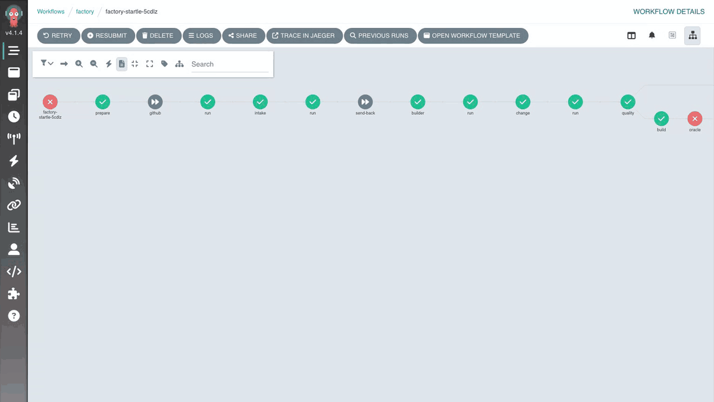

# Lesson 7: The oracle (12 min)

😬 **Problem:** if the agent can read the acceptance tests, it writes code to pass those tests instead of doing what was asked. Then the tests stop telling you anything.

🛠️ **What we do:** we hide the tests written by people from the agent. It cannot even open them. The factory runs them on its own, from the main branch.

✅ **What you get:** a test the agent cannot cheat on: your honest signal that the job is done.

## How it works

The oracle is the set of hidden tests (scenarios) written by people. They check the requirement, whatever the
code looks like. Each time the agent learns something about a scenario, the scenario leaks a little, so the
oracle has two levels:

- **Working scenarios** (`scenarios/controls`, `scenarios/startle`, `scenarios/hud-speed`, `scenarios/regression`).
  On a second attempt the agent gets their names, never their code or data.
- **The vault** (`scenarios/vault-controls`, `scenarios/vault-startle`). It gives a verdict and zero feedback.
  A failure stops the line (andon), because a retry "for the vault" would turn it into training data. The vault
  opens only after the working scenarios pass.

In the line the oracle is the `oracle` task in the `quality` step. It always takes the scenarios from `main`,
never from the change's branch, and runs them as vitest files against the change (`sdlc/scenarios.py` puts them
in `system/.oracle/`). The oracle is the factory's real asset: the agent driver is about a hundred lines, and
everyone has the same models.

## ✏️ Exercise: hide the oracle from the agent (8 min)

1. Set up the lesson: `factory lesson 7`.
2. Run the startle work order: `make replay O=startle`.
   👀 You should see: `Result: Failed`. On the floor: build green, secrets green, oracle red.
3. Fetch the results: `make fetch`, then `cat .sdlc/out/startle/attempt-1/quality-5-oracle.md`.
   👀 You should see: the failed scenario "A startle that begins in the air still falls and lands".

   
   The floor: the oracle step is red; its log shows 5 of 6 scenarios green and ❌ "A startle that begins in the air still falls and lands".

4. Run `factory check 7`.
   🔴 You should see: `in the cluster HIDDEN_PATHS has no scenarios` and `the server shows scenarios/ to the agent`.
5. 🔑 With a model key (no key: skip to step 6). Ask the builder to read a hidden test **now, before you hide it**:
   `factory ask builder "Read scenarios/startle/startle.test.ts and summarize what it checks"`
   👀 You should see: a summary of the scenario. Writes to `scenarios/` were blocked in lesson 2, reads were not.
6. Open `platform/workshop/mcpserver.yaml` and set `HIDDEN_PATHS` to `scenarios`.
7. Send it to the cluster: `kubectl apply -f platform/workshop/mcpserver.yaml`.
8. Wait for the server to restart: `kubectl rollout status -n factory deploy/workshop --timeout=180s`.
9. 🔑 With a model key: ask the same question again, `factory ask builder "Read scenarios/startle/startle.test.ts and summarize what it checks"`.
   👀 You should see: `Rejected: … is out of the agent's reach`, and the try is recorded:
   `kubectl exec -n factory deploy/depot -- grep holdout.peek /work/events.jsonl`.
10. Run `factory check 7`.
   🟢 You should see: `reading the oracle rejected by the server` and `the wall from lesson 2 still stands`.

Stuck? `factory solve 7`.

What went wrong in step 3: the first attempt passed the agent's own tests and every structural gate. The agent
froze the whole player step in `game/sim/player.ts` for `CREATURE_STARTLE_TICKS`. Gravity stopped together with
the input, so a wizard startled in mid-air hangs there. That is the same bug as
`ops/incidents/2026-09-30-wizard-hangs-mid-air.md`, where a victory did it. The vault stays `unopened`, because
the working scenarios did not pass.

The scenarios are in the same repo, so "the agent cannot see them" means two things: the workshop server
hides them, and the line takes them from `main`. In production you keep the vault in a separate repo.

Optional: `make naive` now shows a red `build` gate. The rule from lesson 6 catches `Math.random()` in `game/sim/tick.ts`.

## To discuss

- Who in your company will write a scenario the agent never sees? Product? QA? The game designer?
- How many times can you show the agent a scenario's name before it stops being hidden?
