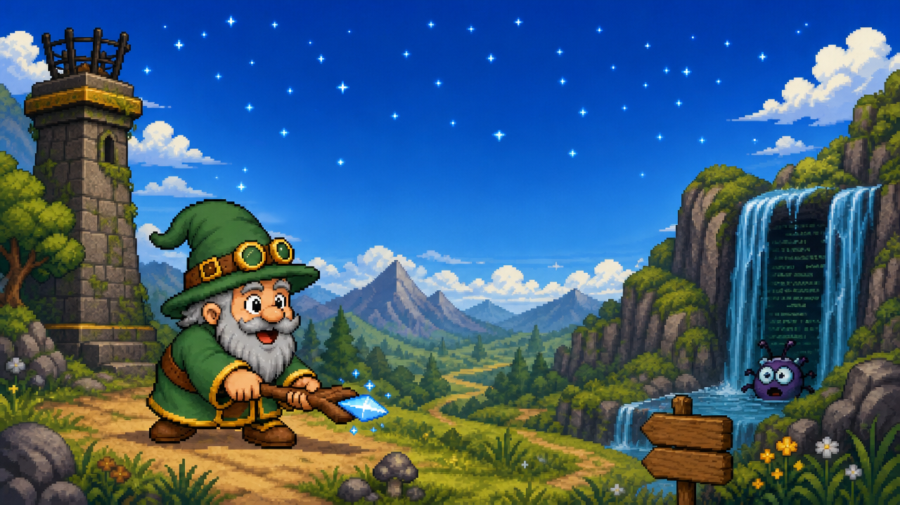

# Hobby Wizard and the Hidden Bug

A browser pixel-art platformer whose codebase is the sandbox for Visdom. Real defects are planted in the game and show up in the world as creatures. You play, feel that something is wrong, find the evidence, and hand the bug to Visdom, which fixes the game with a reviewed pull request. Then you play the fix.

## What happens when you find a bug

1. Land on the game, where the planted bug is still intact. The premise is the whole game: this one has bugs, real ones — find them, hand them to Visdom, watch it fix them.
2. Play the forest. Something is off.
3. Meet the creature and feel the symptom. A card names it in plain words, with a clue to where it lives but never a file.
4. Find the evidence at the waterfall of logs. The card now names the bug and offers to raise a ticket.
5. Raise it. Within two minutes Visdom has refined the ticket and has a hypothesis about the cause; within twenty it has opened a pull request, reviewed by a second model, with a preview you can play.
6. Play the preview. The symptom is gone, the creature is gone, the beacon burns. That is the whole loop: the pull request stays open as the record of how the fix got there, and the shared world keeps its bug for the next visitor.

## Play a preview

You never have to check anything out to play a fix. CI builds every push on a branch and deploys it to Cloudflare Workers under an alias made from the branch name, and the pull request carries that URL in a comment. There is one URL per branch and it does not change while the branch lives; each push replaces what it serves.

## Run it

Node 22 or newer, and pnpm.

```
pnpm install    # once
pnpm dev        # http://localhost:5173
pnpm build      # production build into dist/
```

## Controls

Keyboard only in Season 1.

| Action | Keys |
|---|---|
| left / right | arrows or A / D |
| jump | Z, Space, up arrow or W |
| charge (attack) | X or J |
| down | down arrow or S |
| raise ticket | T |
| restart | R |
| hitboxes and tiles over a painting | F1 |
| start | Enter, Space or Z on the title |

Enter never restarts a run. Gamepad and touch come later.

## How it is built

- TypeScript, Vite, PixiJS for rendering, Vitest for tests.
- Deployed as a static site on Cloudflare Workers from GitHub Actions, one preview per branch.
- Levels are painted images traced to collision; art is drawn at two pixels per world unit.
- Planted bugs live in a manifest, each paired with a test that fails while the bug exists and passes when it is fixed. Fixing one is exactly one pull request.
- Tickets are GitHub issues in this repository. Season 1 ships its bugs in one room, the glade, one creature at a time.
- Every decision is a short record under `docs/plan/01-decisions/`; the newest record wins on a conflict.

## How the game works

The simulation is deterministic: sixty ticks a second, no clocks, no randomness outside a seed in the state. A recorded run replays exactly, so every movement rule has a replay test. The renderer only reads the state and never keeps time of its own. Each room has one waterfall that hides the log lines of that room's bug behind the water; part it and read them. The rules for anyone, human or agent, working in this repository are in [AGENTS.md](AGENTS.md), copied from `docs/plan/02-design/agents-rules.md`.

## How Visdom builds it

The plan under `docs/plan/` is complete: the vision, nine decision records, the design, the art briefs and 55 tickets in nine milestones. Visdom takes the tickets in dependency order and opens one pull request per ticket, with a preview to play; a human reviews each one and supplies art where a ticket asks for it. Once the bug quest is in, Visdom moves to the other side of the loop and fixes the planted bugs from the game's own tickets.

| Milestone | Done when |
|---|---|
| M0 Repository, toolchain, CI, deploy | green CI on `main`; a PR gets a preview URL |
| M1 Deterministic simulation | every tuning rule has a replay test; the glade playthrough reaches the beacon |
| M2 Renderer | the settled look at 640 by 360; nothing reads wall time |
| M3 Asset kit and trace tool | `pnpm assets` is idempotent; a room round-trips through the trace tool |
| M4 Season 1 content | one room, the glade, tile-drawn and complete; the run reaches its beacon |
| M5 Bug Quest | the planted bugs proven both ways; the world heals per branch |
| M6 Atmosphere and audio | 60 fps; sounds follow simulation events |
| M7 Visdom integration | the planted bug goes from issue to a reviewed PR with a preview through Visdom alone |
| M8 Launch hygiene | ten trial visitors complete the loop unassisted |

## Art

The art is generated from written prompts, kept in `docs/plan/03-assets/prompts/`. Every raw in `assets/` carries a row in [assets/PROVENANCE.md](assets/PROVENANCE.md) saying how and when it was made and what the asset kit turns it into; `pnpm assets:report` names any raw that has no row. Original character, original places, no borrowed compositions.

## Where things stand

9 October 2026. Season 1 is one room — the forest glade, drawn in tiles ([ADR-009](docs/plan/01-decisions/ADR-009-one-room.md)) — and it plays from the title screen to the beacon: the deterministic simulation with a replay test for every movement rule, the dusk look, the asset kit and the trace tool, the waterfall of logs and the ticket card, particles and the creature's glitch aura, and now sound — effects that follow simulation events, a night forest under everything, a waterfall that swells as the wizard nears it (HWP-063, then the owner's rework in #145). One bug is planted, HW-001, paired with a test that fails while it is there; HW-002 was healed on 8 October so that the HW-001 fix preview shows a clean world (ADR-009, amendment). M0 to M7 are closed: on 9 October the owner settled the story to its core — find the bug, raise the ticket, wait, play the fix on its pull request's preview — with one deployed world and no merge policy or branch ladder ([ADR-010](docs/plan/01-decisions/ADR-010-the-loop-is-issue-to-pull-request.md)); the planted-bug flow has run that loop end to end twice. Left in M8: ten trial visitors who have to finish the loop unassisted. The plan is written before the code and committed in the order it is written, so the history of this repository is the history of its decisions.

## Read more

- [The plan and how it is consumed](docs/plan/README.md)
- [The tickets](docs/plan/tickets/)
- [The game concept](docs/plan/00-vision/game-concept.md)
- [The visitor's first five minutes](docs/plan/00-vision/visitor-journey.md)
- [Decision records](docs/plan/01-decisions/)
- [Design documents](docs/plan/02-design/)
- [Art direction and asset briefs](docs/plan/03-assets/)

## Licence

Code is Apache-2.0; the terms are in [LICENSE](LICENSE).

The art is original work — original character, original geography, no borrowed compositions — and its clearance is the provenance record above, not the fact that a model drew it. "AI-generated" is not a licence.

The sound effects and the forest ambience loop (HWP-063) are original too and carry their provenance the same way.
